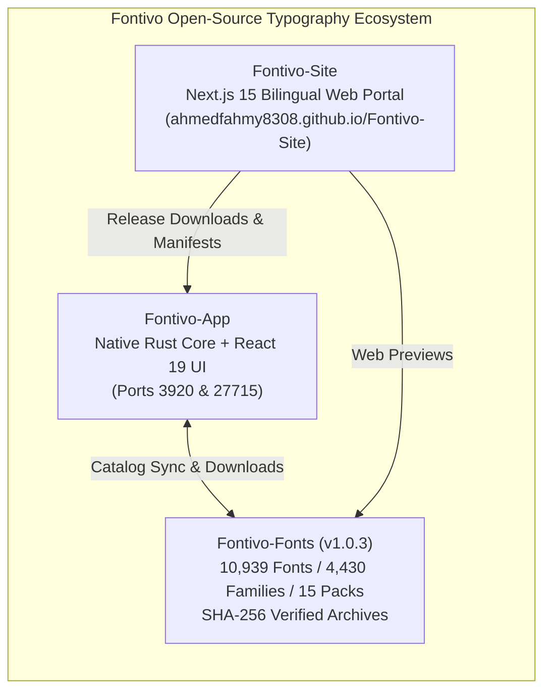

# Fontivo-App — AI Agent Guidelines & Architecture Manual

> **Document Classification:** Core Engineering Standard, Cross-Repo Contract & Operational Handbook  
> **Target Audience:** AI Agents (Coding Assistants, Autonomous Agents, Swarm Workers) & Human Contributors  
> **Repository:** [Ahmedfahmy8308/Fontivo](https://github.com/Ahmedfahmy8308/Fontivo)  
> **Official Website:** [ahmedfahmy8308.github.io/Fontivo-Site](https://ahmedfahmy8308.github.io/Fontivo-Site/)  
> **Developers & Ownership:**
> - **Eng. Ahmed Fahmy** — Software Engineer ([GitHub (@Ahmedfahmy8308)](https://github.com/Ahmedfahmy8308) • [Portfolio](https://ahmed-fahmy.engineer/))
> - **Eng. Mohamed Elashwah** — Graphic Designer ([Portfolio](https://mohamed-elashwah.me/))

---

## 1. Project Overview & Mission

**Fontivo** is a native, high-performance desktop font management, brand identity, and creative asset suite for Windows, macOS, and Linux. It replaces bloated Electron-based font managers (which consume high RAM and pollute the Windows Registry) with a lightweight native Rust core + React 19 interface.

### Core Stack
- **Native Core Engine:** Rust (`src/`), direct Win32 GDI32 / DirectWrite bindings, `tiny_http` embedded REST daemon, and raw TCP/WebSocket socket bridge.
- **Desktop UI:** React 19, Tailwind CSS v4, Vite, TypeScript (`src/ui/`).
- **Memory Footprint:** Idles at **~38.5 MB RAM**.
- **Licensing:** **100% Free & Open-Source (MIT License)** with zero paywalls, zero subscriptions, and zero telemetry.

---

## 2. Ecosystem Relationships & Cross-Repo Ripple Rules

| Repo | Purpose | Link |
| :--- | :--- | :--- |
| **Fontivo-App** *(this repo)* | Native Rust + React 19 Desktop App, Win32 `FR_PRIVATE`, Inno Setup installer | [Ahmedfahmy8308/Fontivo](https://github.com/Ahmedfahmy8308/Fontivo) |
| **Fontivo-Site** | Bilingual (`/en` & `/ar` RTL) Next.js 15 static portal, docs, SEO/GEO & downloads | [Ahmedfahmy8308/Fontivo-Site](https://github.com/Ahmedfahmy8308/Fontivo-Site) |
| **Fontivo-Fonts** | Offline font packs (`v1.0.3`, `10,939` unique fonts, `4,430` families, `15` packs) | [Ahmedfahmy8308/Fontivo-Fonts](https://github.com/Ahmedfahmy8308/Fontivo-Fonts) |

### What Must Sync Elsewhere After Changes Here
1. **After rebuilding a release (`scripts/build-release.ps1`):**
   - `Fontivo-Setup.exe` size and SHA-256 change → update `Fontivo-Site/src/config/version.ts` (`FONTIVO_INSTALLER_SIZE_BYTES`, `FONTIVO_INSTALLER_SIZE_FORMATTED`, `FONTIVO_INSTALLER_SHA256`, `FONTIVO_VERSION`) and `Fontivo-Site/public/api/manifest.json`, then rebuild `Fontivo-Site`.
2. **After updating `assets/diagrams/*.svg` (`architecture-diagram.svg`, `benchmarks.svg`, `fontivo-hero-demo.svg`):**
   - Copy updated SVGs to `Fontivo-Site/public/diagrams/` and verify references in `README.md`.
3. **After `Fontivo-Fonts` publishes a new release or pack manifest:**
   - Update `FontPackManifest::default_manifest()` in Rust and corresponding assertions in `tests/`.



---

## 3. System Architecture & Subsystems

The core application is organized under `Fontivo-App/src/`:

```text
Fontivo-App/
├── Cargo.toml                  # Native Rust manifest (Win32, Unix, macOS dependencies)
├── build.rs                    # Windows manifest & icon resource compiler
├── assets/                     # Brand marks, social OG image, animated SVG diagrams
├── installer/                  # Inno Setup installer configuration
├── scripts/                    # Build, release, and dev-check automation scripts
├── src/
│   ├── main.rs                 # Process entry point, lifecycle, window initialization (Tao/Wry)
│   ├── lib.rs                  # Public engine facade and module re-exports
│   ├── fontivo_core/           # Engine lifecycle, RAM font virtualization, screen eyedropper
│   ├── fontivo_parser/         # Zero-copy TTF, OTF, TTC, WOFF/WOFF2 SFNT table parser
│   ├── fontivo_scanner/        # Parallel font indexing & Adobe (.psd, .ai, .indd) scanner
│   ├── fontivo_server/         # Dual daemon: REST API (:3920) & Adobe CC Socket Bridge (:27715)
│   ├── fontivo_collections/    # Tagging, favorites, workspaces, and smart collections
│   ├── fontivo_google/         # Offline-first Google Fonts catalog cache & streaming sync
│   ├── fontivo_updater/        # Cryptographically verified SHA-256 update checks
│   ├── fontivo_watcher/        # Cross-platform filesystem directory watcher
│   └── ui/                     # React 19 + Tailwind CSS + Vite + TypeScript frontend
├── tests/                      # Rust integration & server test suites
└── docs/                       # Technical specifications
```

### Detailed Subsystem Breakdown
1. **`fontivo_core`:** In-memory font virtualization via Win32 GDI32 `AddFontResourceExW` (`FR_PRIVATE`), global `WM_FONTCHANGE` broadcast to active creative tools, clean handle teardown on exit, and circular Win32 GDI screen color picker lens.
2. **`fontivo_parser`:** Zero-copy SFNT table parser (`.ttf`, `.otf`, `.ttc`, `.woff`, `.woff2`) extracting glyph, name, horizontal metrics, OS/2, and OpenType layout tables (`GSUB`, `GPOS`).
3. **`fontivo_scanner`:** Parallel directory indexing and `.psd` / `.ai` / `.indd` missing-font extraction.
4. **`fontivo_server`:** REST API daemon (`127.0.0.1:3920`) + Adobe CC socket bridge (`127.0.0.1:27715`).
5. **`fontivo_collections` & `fontivo_google`:** Local-first catalog caching, smart workspaces, favorites, and offline-first font packs (`10,939` unique fonts across `4,430` families).
6. **`fontivo_watcher` & `fontivo_updater`:** Event-driven filesystem watching and SHA-256 verified update checks.

---

## 4. Networking Protocols & Ports

| Port | Protocol | Binding | Purpose |
| :--- | :--- | :--- | :--- |
| **`3920`** | HTTP / REST | `127.0.0.1` | Embedded REST API serving UI requests, font activation, collections, and swatch exports. |
| **`27715`** | TCP / WebSocket | `127.0.0.1` | Adobe Creative Cloud Bridge for real-time auto-activation and document font inspection. |

> [!CAUTION]
> **Loopback Binding Invariant:** Never change `127.0.0.1` to `0.0.0.0` or expose either daemon over public network interfaces.

---

## 5. Scope Guardrails & Non-Negotiable Core Invariants

### Allowed Modification Scope
- Rust backend modules (`src/fontivo_*`) and integration tests (`tests/`).
- React 19 desktop UI (`src/ui/src/`) and UI tests (`src/ui/tests/`).
- Diagrams (`assets/diagrams/`), installer scripts (`installer/`), and documentation (`docs/`).

### Forbidden / Non-Negotiable Rules
1. **Zero Registry Bloat (`FR_PRIVATE` In-Memory Virtualization):**
   - **NEVER** copy activated fonts into `C:\Windows\Fonts` or write persistent registry keys during RAM activation. Always use `AddFontResourceExW` (`FR_PRIVATE`) and unmap transient handles on deactivation or exit.
2. **OS-Installed Fonts Are Strictly Read-Only (`source == "system"`):**
   - **NEVER** allow toggling, activating, or deactivating Windows OS-installed fonts in RAM. Both Rust (`fonts_lifecycle.rs`) and UI (`FontCard.tsx`, `FamilyCard.tsx`) must enforce read-only `"OS Installed"` status.
3. **100% Free, Open-Source & Zero Telemetry:**
   - Permanent MIT license; zero paywalls, subscriptions, telemetry, analytics, or unrequested phone-home requests.
   - Loopback strictly isolated to `127.0.0.1` (`:3920` and `:27715`).
4. **Permanent Adobe CC Bridge & Low Resource Footprint (~38.5 MB Idle RAM):**
   - Never gate or remove Adobe CC `:27715` auto-activation, and never bundle Electron/Chromium/CEF runtimes.
5. **Preserve Existing Tests & Docs:**
   - Never delete or bypass Rust or UI test suites; keep `npx tsc --noEmit` at 0 errors.
   - Do not create duplicate docs outside centralized structure, and always use clean **Software Engineer** (Eng. Ahmed Fahmy) & **Graphic Designer** (Eng. Mohamed Elashwah) role titles without inflated titles.

---

## 6. UI & Color Palette Rules

- **Theme:** Unified **Plum / Coral / Lavender** design system (`--color-back-main`, `--color-back-card`, `--color-action` `#F16B50`, Lavender `#B7A1D9`, Warm Paper `#FFF9F2`).
- Avoid jarring multi-color / rainbow icons, status dots, or mismatched colored headers — keep badges, icons, and pills harmonious within Plum, Coral, and Lavender.
- **Header & Views:**
  - Never add a redundant version pill (`v1.0.0`) next to the top `HeaderBar` logo.
  - System & RAM Health top processes are capped at **Top 5**, and RAM trim actions require explicit confirmation.

---

## 7. Verification Gates (Run Before Finishing)

```powershell
# UI checks
Push-Location Fontivo-App/src/ui
npx tsc --noEmit
npm run lint
npm test
npm run build
Pop-Location

# Full Rust + UI + Site gate
Push-Location Fontivo-App
cargo test
cargo fmt --check
powershell -NoProfile -ExecutionPolicy Bypass -File scripts/dev-check.ps1 -Gate all
Pop-Location
```
