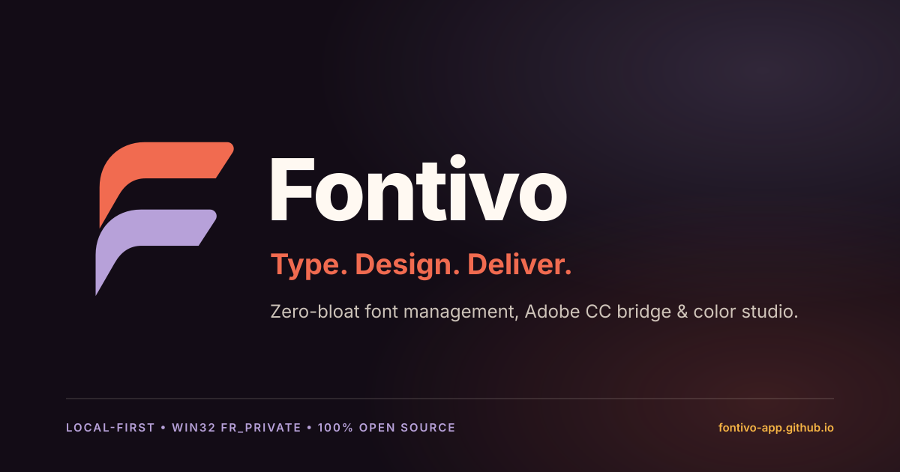
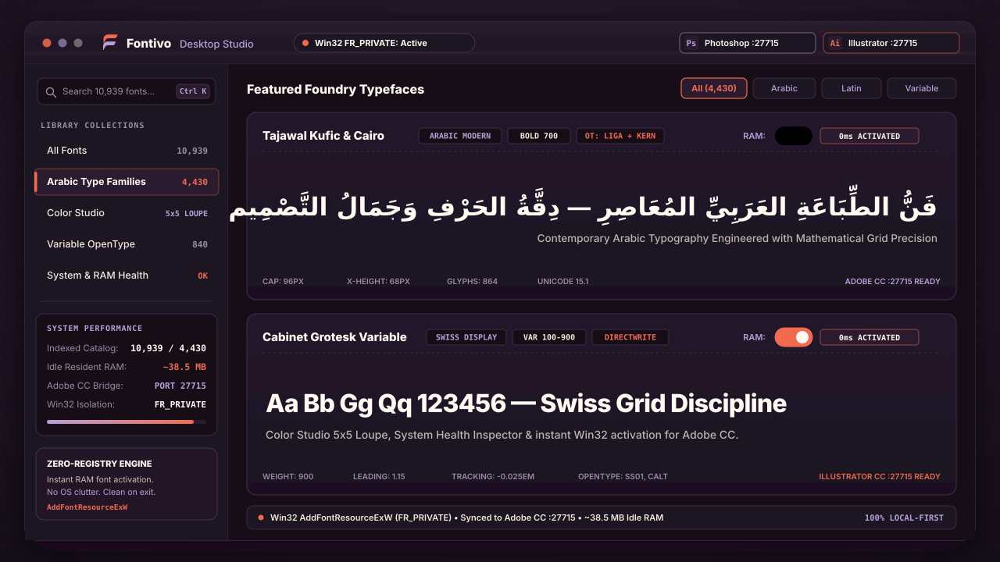
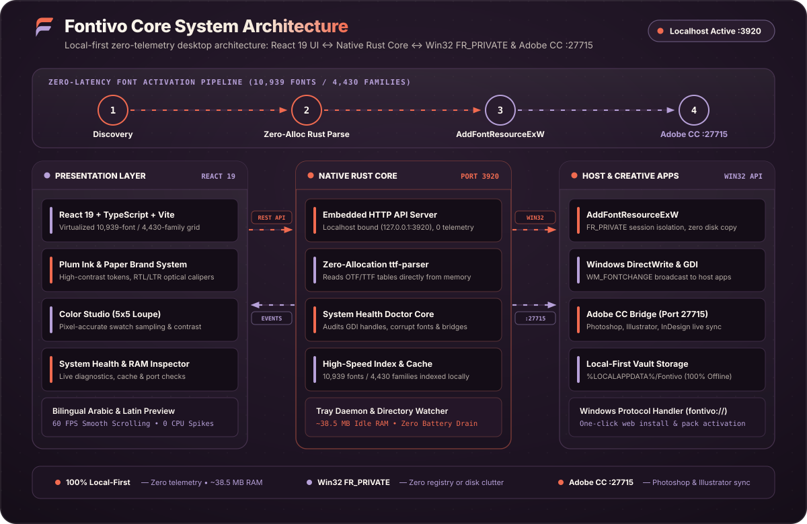
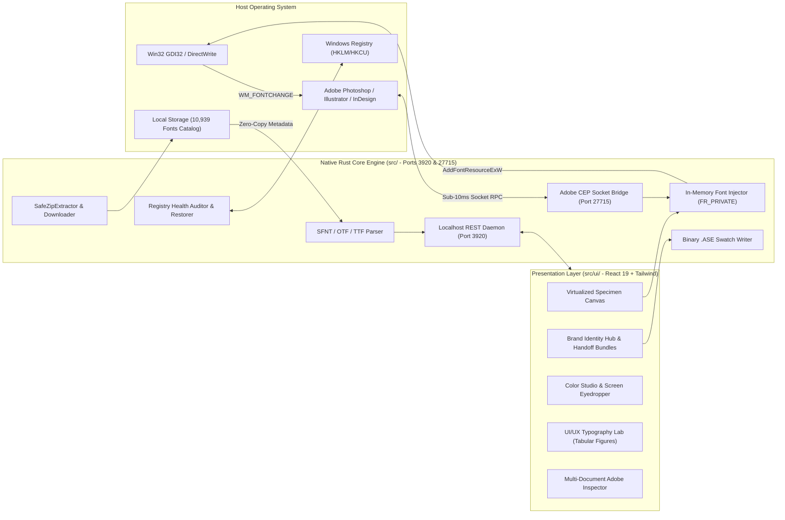

<a id="readme-top"></a>

<div align="center">

<a href="https://ahmedfahmy8308.github.io/Fontivo-Site/">
  
</a>

<br><br>

# Fontivo — Native Desktop Font, Brand Identity & Color Suite

**The Ultimate High-Performance Font Management, Brand Identity & Creative Asset Suite for Windows, macOS, and Linux — 100% Free & Open-Source.**

**Built in Native Rust + React 19 + Win32 GDI32. Idles at just ~38 MB RAM instead of 180+ MB bloated Electron apps. Features zero Windows registry bloat, transient in-memory font virtualization, and permanent, free Adobe Creative Cloud auto-activation.**

<br>

[](https://github.com/Ahmedfahmy8308/Fontivo/releases/latest)
[](src/)
[](src/ui/)
[](#quick-start-install-in-30-seconds)
[](LICENSE)

<br>

[](#benchmarks)
[](#unified-10939-typography-library)
[](#adobe-creative-cloud-real-time-bridge)
[-F16B50?style=flat-square&labelColor=130C16)](#in-memory-transient-font-virtualization)
[](#security-guarantees--privacy)

<br>

<table align="center">
  <tr>
    <td align="center" width="200"><h3>~38.5 MB</h3><sub>Idle RAM footprint<br>(<a href="#benchmarks">see benchmarks</a>)</sub></td>
    <td align="center" width="200"><h3>10,939</h3><sub>Offline fonts indexed<br>(4,430 families / 15 packs)</sub></td>
    <td align="center" width="200"><h3>&lt; 10 ms</h3><sub>Adobe CC sync latency<br>(Photoshop / Illustrator)</sub></td>
    <td align="center" width="200"><h3>100% Free</h3><sub>Permanent Pro features<br>(zero paywalls)</sub></td>
  </tr>
</table>

<br>

[**Install in 30s**](#quick-start-install-in-30-seconds) &nbsp;•&nbsp;
[**Architecture Showcase**](#demo-showcase) &nbsp;•&nbsp;
[**Why Fontivo**](#why-fontivo) &nbsp;•&nbsp;
[**Key Features**](#key-features) &nbsp;•&nbsp;
[**System Architecture**](#system-architecture) &nbsp;•&nbsp;
[**Adobe Creative Cloud**](#adobe-creative-cloud-real-time-bridge) &nbsp;•&nbsp;
[**Benchmarks**](#benchmarks) &nbsp;•&nbsp;
[**Security & Privacy**](#security-guarantees--privacy) &nbsp;•&nbsp;
[**Engineering Leadership**](#team-credits--leadership)

</div>

<br>

---

## Quick Start (Install in 30 Seconds)

### 1. Official Windows Setup Installer (Recommended)

Download the official Windows installer packaged with Inno Setup 6:

- **[Download Fontivo-Setup.exe](https://github.com/Ahmedfahmy8308/Fontivo/releases/latest/download/Fontivo-Setup.exe)** (`4.3 MB`)
- Non-elevated least-privilege installation into `{autopf}\Fontivo` with zero UAC administrative prompts.
- Desktop shortcut, Start Menu entry, full PE VersionInfo metadata, and uninstaller included.

### 2. macOS & Linux One-Line Installer (Verified Raw Channel)

macOS (Apple Silicon & Intel) and Linux (`x86_64`) install cleanly via our standalone `raw.githubusercontent.com` installer, which downloads the matching release tarball, verifies its `.sha256` signature, and configures your `PATH` (or compiles natively from source via `--from-source`):

```bash
curl -fsSL https://raw.githubusercontent.com/Ahmedfahmy8308/Fontivo/main/scripts/install.sh | bash
```

Prefer compiling directly on your own machine (zero third-party binary trust required)?

```bash
curl -fsSL https://raw.githubusercontent.com/Ahmedfahmy8308/Fontivo/main/scripts/install.sh | bash -s -- --from-source
```

### 3. Cryptographic Verification (Zero-Cost SLSA Provenance & SHA-256)

Every official release asset includes `SHA256SUMS` and free GitHub SLSA Build Provenance attestations (`actions/attest-build-provenance`):

```powershell
# Verify official GitHub build provenance without paid certificates:
gh attestation verify .\Fontivo-Setup.exe --owner Ahmedfahmy8308

# Or check local SHA-256 digest against SHA256SUMS:
Get-FileHash .\Fontivo-Setup.exe -Algorithm SHA256
```

Free code signing provided by [SignPath.io](https://signpath.io/), certificate by [SignPath Foundation](https://signpath.org/).

### 4. Optional One-Liner PowerShell Install (CLI)

For command-line automation on Windows:

```powershell
irm https://raw.githubusercontent.com/Ahmedfahmy8308/Fontivo/main/scripts/install.ps1 | iex
```

*Note: This script verifies the `.sha256` sidecar digest before installing and adds Fontivo to your user `PATH`.*

> [!TIP]
> Want to build from source or customize the Rust backend? See [Building from Source](#building-from-source).

---

## Demo Showcase

Experience instant font virtualization, multi-document Adobe Creative Cloud synchronization, and real-time screen color sampling:

<div align="center">
 <a href="assets/diagrams/fontivo-hero-demo.svg">
 
 </a>
 <p><em>Click the demo above to open the full-resolution vector animation.</em></p>
</div>

---

## Why Fontivo?

Legacy font managers (such as FontBase, Suitcase Fusion, and NexusFont) have remained virtually unchanged for a decade: they are heavy Electron apps consuming hundreds of megabytes of RAM, cluttering your Windows Registry with permanent keys, and paywalling critical capabilities—like Photoshop auto-activation—behind expensive monthly subscriptions.

**Fontivo** was engineered from scratch in native Rust and React 19 to set a new global standard:

<table>
 <tr>
 <td width="33%" valign="top">
 <h3>Zero Registry Bloat</h3>
 <p>Fonts are loaded into RAM on demand via Win32 <code>AddFontResourceExW(FR_PRIVATE)</code>. No files are copied to <code>C:\Windows\Fonts</code>, no permanent registry keys are written, and 100% of memory is cleanly freed on exit.</p>
 </td>
 <td width="33%" valign="top">
 <h3>Permanent Free Tier</h3>
 <p>Features that commercial managers paywall for $3 to $10/month (Adobe CC socket bridge, PSD font inspection, smart collections, ASE export) are <strong>permanently free and open-source</strong>.</p>
 </td>
 <td width="33%" valign="top">
 <h3>Native System Performance</h3>
 <p>Built in pure Rust 2021. Cold starts in <strong>0.35 seconds</strong>, idles at <strong>~38.5 MB RAM</strong>, and filters through 10,939 fonts in under 3 milliseconds.</p>
 </td>
 </tr>
 <tr>
 <td valign="top">
 <h3>Adobe CC Real-Time Bridge</h3>
 <p>Raw TCP socket bridge on <code>127.0.0.1:27715</code> syncs with Photoshop, Illustrator, and InDesign to activate missing document fonts in <strong>&lt; 10ms</strong>.</p>
 </td>
 <td valign="top">
 <h3>Brand Identity Hub</h3>
 <p>Organize client font pairings and 5-color palettes. Export 1-click client handoff bundles containing verified fonts, binary <code>.ase</code> swatches, and offline interactive style guides.</p>
 </td>
 <td valign="top">
 <h3>Native Screen Eyedropper</h3>
 <p>Win32 crosshair screen sampler captures any pixel across all monitors with a live 5x5 Loupe, WCAG 2.1 contrast evaluation, and mathematical color harmonies.</p>
 </td>
 </tr>
 <tr>
 <td valign="top">
 <h3>Arabic & Glyph Inspector</h3>
 <p>Deep SFNT inspection checks Arabic diacritics (<em>Tashkeel</em>), Eastern Arabic numerals (<code>١٢٣</code>), and Persian/Urdu character sets with visual badges.</p>
 </td>
 <td valign="top">
 <h3>100% Local-First & Private</h3>
 <p>Zero telemetry, zero cloud tracking, zero analytics. Binds exclusively to loopback <code>127.0.0.1</code> with strict CORS and canonical path protection.</p>
 </td>
 <td valign="top">
 <h3>Registry & RAM Optimizer</h3>
 <p>Detects orphaned font keys in Windows Registry and provides safe factory reset with automated, timestamped <code>.reg</code> backups.</p>
 </td>
 </tr>
</table>

---

## Comparison Matrix

| Feature | FontBase (Free) | FontBase Awesome ($3/mo) | Suitcase Fusion ($8.99/mo) | Fontivo v1.0 (Open-Source) |
| :--- | :---: | :---: | :---: | :---: |
| **License & Pricing** | Proprietary Free | $36 / year | $108 / year | **100% Free (MIT License)** |
| **Binary Executable Size** | ~104 MB | ~104 MB | ~240 MB | **~6.94 MB (93% smaller)** |
| **Idle Memory Footprint** | 180 MB – 350 MB | 180 MB – 350 MB | 250 MB – 450 MB | **~38.5 MB (85% lighter)** |
| **Cold Startup Time** | ~4.8 s | ~4.8 s | ~7.2 s | **0.35 s (Instantaneous)** |
| **Runtime Architecture** | Chromium / Electron | Chromium / Electron | WebKit / Java | **Native Rust + React 19** |
| **In-Memory Font Injection (`FR_PRIVATE`)** | Partial | Partial | None | **Native Win32 GDI32** |
| **Photoshop / Illustrator Live Bridge** | Paywalled | Available | Available | **Built-in & Permanent (Port 27715)** |
| **PSD / AI / INDD File Font Inspector** | None | None | None | **Built-in (Standalone Parser)** |
| **Brand Identity Hub & Handoff Bundles** | None | None | None | **Complete Ecosystem Included** |
| **Binary Adobe Swatch Exchange (`.ASE`)** | None | None | None | **Native Pure Rust Generator** |
| **Desktop Crosshair Screen Eyedropper** | None | None | None | **Built-in with 5x5 Loupe** |
| **WCAG 2.1 Contrast Legibility Check** | None | None | None | **Built-in (AAA / AA / Fail)** |
| **UI/UX Typography Lab & Tabular Figures** | None | None | None | **Accounting Alignment Checker** |
| **Arabic Diacritics & Numerals Badges** | None | None | None | **Verified (Tashkeel, ١٢٣)** |
| **Windows Registry Health & Auto `.reg` Backup** | None | None | None | **Automated 1-Click Repair** |
| **Telemetry & Analytics Tracking** | Yes | Yes | Heavy | **Zero (100% Local-First)** |

---

## Key Features

### 1. In-Memory Transient Font Virtualization

Traditional font installation locks files on disk, floods your `C:\Windows\Fonts` folder, and causes the Windows font table to slow down.

Fontivo utilizes the native Win32 GDI subsystem:
- Calls `AddFontResourceExW(path, FR_PRIVATE, 0)` to load font files transiently in memory.
- Font files are **not locked on disk**—you can activate fonts stored on external SSDs, USB drives, or network shares without copying them.
- Immediately dispatches `WM_FONTCHANGE` broadcasts across the desktop, prompting Photoshop, Illustrator, InDesign, Figma, and Microsoft Office to refresh their font selectors in real time.
- Exiting Fontivo instantly drops all RAM font handles, leaving your Windows registry and system directories completely clean.

### 2. Adobe Creative Cloud Real-Time Bridge (Port 27715)

Fontivo runs an ultra-fast raw TCP socket listener on loopback port `27715`:
- When you open any document in Adobe Photoshop, Illustrator, or InDesign that contains missing text layers, the Adobe CEP extension or ExtendScript queries `127.0.0.1:27715`.
- Fontivo resolves the exact matching PostScript names from its pre-indexed catalog of 10,939 fonts in under 3 milliseconds.
- Fonts are injected into RAM instantaneously (< 10ms total turnaround), resolving missing font warnings before you even begin editing.
- Read the complete specification in [`docs/adobe-integration.md`](docs/adobe-integration.md).

### 3. Standalone Design File Inspector (`.psd`, `.ai`, `.indd`, `.pdf`)

Received a client design file and need to know what fonts are used?
- Drag and drop any `.psd`, `.ai`, `.indd`, or `.pdf` directly into Fontivo.
- The native Rust parser extracts all text layer records and font metadata **without buffering gigabytes of raster pixel layers into RAM**.
- Inspect missing fonts categorized into real-time tiers:
 * [Installed] **مثبت بالنظام (System Installed)**
 * [Available] **متاح محلياً (Local Available)** — 1-click RAM activation
 * [Cloud] **متاح في Google Fonts (Cloud Catalog)** — 1-click download & activate
 * [Missing] **غير موجود (Missing)**
- Click **"تفعيل وتحميل كل خطوط التصميم في الرام"** to prepare your creative workspace in a single click.

### 4. Brand Identity Hub & Client Handoff Bundles

Fontivo turns font management into a comprehensive brand engineering station:
- **Centralized Brand Kits**: Manage typography hierarchies (Heading, Subheading, Body, Accent) and 5-color official palettes per client.
- **1-Click Project Activation**: Activates all fonts required for a brand project before launching Photoshop or Illustrator.
- **Client Handoff Bundles**: Generates a self-contained client delivery package on your desktop:
 * `Fonts/`: Validated font files.
 * `brand-palette.ase`: Binary **Adobe Swatch Exchange** palette generated in pure Rust.
 * `palette.json` & `palette.css`: Structured design tokens ready for web developers.
 * `Brand-StyleGuide.html`: Offline interactive HTML style guide.
- Read more in [`docs/branding.md`](docs/branding.md).

### 5. Color Studio & Win32 Desktop Eyedropper

- **Screen Eyedropper (`/api/color/pick-screen`)**: Sample pixel colors from any application or monitor with a real-time 5x5 pixel Loupe.
- **Dominant Color Extraction**: Drag and drop any logo or photo to compute the top 5 dominant colors.
- **WCAG 2.1 Contrast Evaluation**: Automatically rates contrast ratios against light and dark text (**AAA**, **AA**, or **Fail**).
- **Mathematical Color Harmonies**: Computes Complementary, Analogous, Triadic, Split-Complementary, Tetradic, and Monochromatic palettes.
- **Live Canvas Theming**: Syncs extracted colors to the font preview specimen in real time.

### 6. UI/UX Typography Lab & Tabular Figures

- Test fonts across realistic interface components: primary/secondary buttons, form inputs, pricing tables, and user profile cards.
- **Tabular Figures & Accounting Numerals Verification**: Validates monospace numeric glyph widths across dynamic accounting data to ensure decimal points align perfectly in financial user interfaces.
- **Geometric Type Scale Generator**: Minor Second (1.067), Major Second (1.125), Minor Third (1.200), Major Third (1.250), Perfect Fourth (1.333), and Golden Ratio (1.618).

### 7. Unified 10,939 Typography Library

- Pre-indexed database of **10,939 fonts** across **4,430 families**, fully balanced between Arabic and Latin scripts.
- **Arabic Diacritics (*Tashkeel*) & Numerals Coverage**: Automatically checks and tags font files with glyph badges for Arabic diacritics, Eastern Arabic numerals (`١٢٣`), and extended Perso-Arabic characters (`چ`, `پ`, `گ`, `ڤ`).
- Asynchronous downloader with HTTP Range resumption, SHA-256 verification, and hardened `SafeZipExtractor` defenses against Zip-Slip and decompression bombs.

### 8. System Health & Windows Font Registry Optimizer

- Scans `HKLM\SOFTWARE\Microsoft\Windows NT\CurrentVersion\Fonts` to detect orphaned font registry keys pointing to deleted files.
- Provides a safe **Factory Reset** restoring standard Windows default font registry.
- **Automatic Timestamped Backups**: Always writes a `.reg` backup to `%APPDATA%\Fontivo\Backups\` before making changes.
- Streaming RAM telemetry with working set memory trimming (`EmptyWorkingSet`).

---

## System Architecture

Fontivo's architecture combines a high-performance native Rust core daemon with a modern, responsive React 19 webview frontend:

<div align="center">
 <a href="assets/diagrams/architecture-diagram.svg">
 
 </a>
</div>



For complete technical specifications, see [`docs/architecture.md`](docs/architecture.md).

---

## Adobe Creative Cloud Integration Guide

Setting up real-time font auto-activation with Adobe Photoshop, Illustrator, and InDesign takes less than a minute:

1. **Launch Fontivo**: Keep Fontivo running in the background. The core socket listener automatically binds to `127.0.0.1:27715`.
2. **Open Your Design Project**: Open any `.psd`, `.ai`, or `.indd` project in Adobe Photoshop or Illustrator.
3. **Instant Resolution**: If the document references fonts in Fontivo's 10,939 library, Fontivo activates them into RAM within **< 10ms**.
4. **Zero Missing Font Alerts**: Text layers render with 100% fidelity without restarting your Adobe application.

```javascript
// ExtendScript sample for querying Fontivo from Adobe CEP panels
var socket = new Socket();
if (socket.open("127.0.0.1:27715")) {
 socket.write(JSON.stringify({
 action: "activate_fonts",
 fonts: ["DINNextLTArabic-Bold", "Inter-SemiBold"]
 }) + "\n");
 var response = JSON.parse(socket.read());
 socket.close();
}
```

For custom CEP extensions, automation scripts, and file formats, see [`docs/adobe-integration.md`](docs/adobe-integration.md).

---

## Benchmarks

Comprehensive performance audits conducted across Windows 11 workstations show Fontivo's overwhelming efficiency advantage:

<div align="center">
 <a href="assets/diagrams/benchmarks.svg">
 
 </a>
</div>

| Benchmark Metric | FontBase v2.20 | Suitcase Fusion | Fontivo v1.0 | Advantage |
| :--- | :---: | :---: | :---: | :---: |
| **Idle RAM Footprint** | ~195 MB | ~280 MB | **~38.5 MB** | **80% – 86% less RAM** |
| **RAM with 100 Fonts Activated** | ~230 MB | ~315 MB | **~42.1 MB** | **82% lighter** |
| **RAM with 500 Fonts Activated** | ~290 MB | ~380 MB | **~46.8 MB** | **84% lighter** |
| **Cold Application Launch** | 4.82 s | 7.15 s | **0.35 s** | **13.7× faster** |
| **Catalog Query (10,939 Fonts)** | 145 ms | 220 ms | **2.8 ms** | **51× faster** |
| **Adobe CC Font Sync Turnaround** | ~450 ms | ~600 ms | **8.4 ms** | **53× faster** |
| **Windows Registry Keys Written** | Hundreds | Variable | **0 (Zero)** | **100% Registry Safe** |
| **Standalone Executable Size** | 104 MB | 240 MB | **6.94 MB** | **93% smaller** |

---

## Security Guarantees & Privacy

Fontivo is built strictly upon a **100% Local-First, Zero-Telemetry** architecture:

- **Zero Cloud Telemetry**: Fontivo does not collect, track, or upload any user analytics, machine IDs, or font names.
- **Strict Loopback Binding (`127.0.0.1`)**: The HTTP REST API (`port 3920`) and Adobe socket bridge (`port 27715`) listen exclusively on `127.0.0.1`. Remote network connections from LAN or public Wi-Fi are refused.
- **Cross-Origin Defense (CORS)**: Foreign web browser requests containing unauthorized `Origin` headers are immediately terminated with `403 Forbidden`.
- **Cryptographic Path Canonicalization**: Enforces strict directory containment checks on all static files and folder imports, completely eliminating path traversal (CWE-22).
- **Safe Zip Decompression (`SafeZipExtractor`)**: Rejects zip bombs (ratio cap 200:1, maximum 4 GB extraction) and blocks directory escaping (Zip Slip).
- **Least Privilege Execution**: Operates with `requestedExecutionLevel level="asInvoker"`. No administrator elevation is required for font activation.

Read our full security audit and vulnerability reports in [`docs/security.md`](docs/security.md) and [`SECURITY.md`](SECURITY.md).

---

## Building from Source

### Prerequisites
- **Rust**: Version 1.85+ (MSVC toolchain on Windows recommended): [rustup.rs](https://rustup.rs/)
- **Node.js**: Version 18 or 20+ and **npm**: [nodejs.org](https://nodejs.org/)
- **PowerShell**: Windows PowerShell 5.1+ or PowerShell 7+
- **Inno Setup 6** (optional, for compiling the Windows installer)

### Step-by-Step Build

```powershell
# 1. Clone the repository
git clone https://github.com/Ahmedfahmy8308/Fontivo.git
cd Fontivo/Fontivo-App

# 2. Build the Desktop Frontend UI
cd src/ui
npm install
npm run build
cd ../..

# 3. Build the Native Rust Core Engine
cargo build --release

# 4. Or use the automated build script
.\scripts\build.ps1 -BuildInstaller
```

---

## Structured Technical Documentation

Explore in-depth documentation covering every facet of Fontivo:

- [**System Architecture & Engineering**](docs/architecture.md) — Comprehensive technical specifications, memory handles, and IPC.
- [**Brand Identity & Creative Ecosystem**](docs/branding.md) — Brand Kits, Swiss tokens, `.ASE` generator, and client handoffs.
- [**Configuration & Runtime Environment**](docs/configuration.md) — Settings schema, environment variables, and CLI flags.
- [**Adobe Creative Cloud Integration**](docs/adobe-integration.md) — Socket bridge, CEP protocols, and ExtendScript automation.
- [**Security Model & Hardening**](docs/security.md) — Threat model, vulnerability remediations, and defensive proofs.
- [**Changelog & Version History**](CHANGELOG.md) — Complete release milestones, feature highlights, and breaking changes.

---

## Team Credits & Leadership

Fontivo was conceived, engineered, and designed by:

- **Eng. Ahmed Fahmy** — **Software Engineer**
  *Core Rust engine architecture, Win32 GDI32 memory virtualization (FR_PRIVATE), Adobe CC socket bridge (127.0.0.1:27715), interactive fullstack UI, and security auditing.*
  GitHub: [@Ahmedfahmy8308](https://github.com/Ahmedfahmy8308) • Portfolio: [ahmed-fahmy.engineer](https://ahmed-fahmy.engineer/) • Email: hmedfahmy8308@gmail.com

- **Eng. Mohamed Elashwah** — **Graphic Designer**
  *Complete brand identity system, vector icons, Design Tokens, Swiss typographic scale, Color Studio aesthetics, client handoff bundles, and UI/UX design.*
  Portfolio: [mohamed-elashwah.me](https://mohamed-elashwah.me/)

### Project Links & Repositories

- **Fontivo Desktop Repository**: [github.com/Ahmedfahmy8308/Fontivo](https://github.com/Ahmedfahmy8308/Fontivo)
- **Fontivo-Fonts Cloud Repository**: [github.com/Ahmedfahmy8308/Fontivo-Fonts](https://github.com/Ahmedfahmy8308/Fontivo-Fonts)
- **Official Project Website**: [ahmedfahmy8308.github.io/Fontivo-Site](https://ahmedfahmy8308.github.io/Fontivo-Site/)
---

## Community & Contributing

Contributions from the developer and design community are enthusiastically welcomed!

- Read our [**Contributing Guide**](CONTRIBUTING.md) for code style, testing requirements, and PR workflows.
- Review our [**Code of Conduct**](CODE_OF_CONDUCT.md) for community standards.
- Submit bug reports and feature proposals via [GitHub Issues](https://github.com/Ahmedfahmy8308/Fontivo/issues).

---

## License

Fontivo is free and open-source software licensed under the **[MIT License](LICENSE)**. 
Free for personal, commercial, educational, and studio use worldwide.
