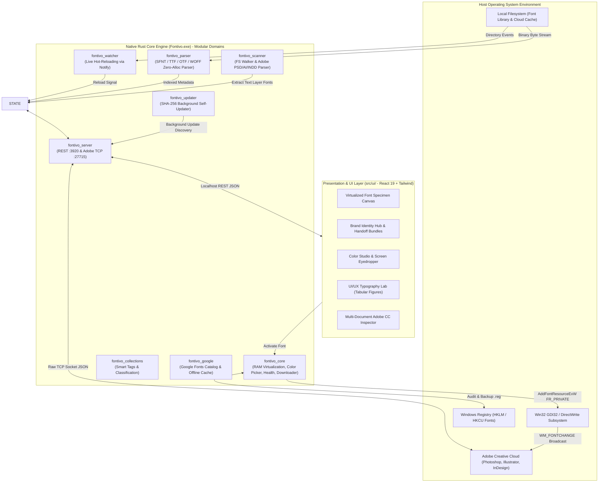

# Fontivo System Architecture & Modular Domain Specifications

> **System Edition**: 1.0.0 (Production GA Release) 
> **Engineering Leadership**: Eng. Ahmed Fahmy (Lead Software & Systems Architect) & Eng. Mohamed Elashwah (Head of Brand Identity & UI/UX) 
> **Repository**: [https://github.com/Ahmedfahmy8308/Fontivo](https://github.com/Ahmedfahmy8308/Fontivo) 
> **Target Platforms**: Windows 10/11 (Primary x64), macOS (Intel & Apple Silicon), Linux (x86_64) 
> **Technology Stack**: Native Rust 2021/2024 (`src/fontivo_*`) + React 19 (`src/ui/`) + Tailwind CSS + Win32 GDI32 / DirectWrite

---

## 1. Architectural Philosophy

Traditional desktop font managers (such as FontBase, Suitcase Fusion, and NexusFont) rely on heavy Chromium/Electron runtimes that consume 180 MB to 400 MB of system RAM, slow down operating system startup, and write thousands of permanent registry keys into `HKLM\SOFTWARE\Microsoft\Windows NT\CurrentVersion\Fonts`.

**Fontivo** was architected from the foundation up in native Rust and React 19 to deliver:

1. **Near-Zero Memory Overhead**: A native, highly optimized Rust engine (`Fontivo.exe`) idling at **~38.5 MB RAM** (85% lower footprint than Electron alternatives).
2. **Transient In-Memory Virtualization**: Fonts are loaded directly into RAM via Win32 `AddFontResourceExW` with the `FR_PRIVATE` flag, leaving **zero disk residue**, locking no font files, and requiring zero administrator elevation.
3. **Instant OS-Wide Propagation**: Broadcasts `WM_FONTCHANGE` upon activation so running creative applications (Adobe Photoshop, Illustrator, InDesign, Figma, Microsoft Office) immediately recognize newly loaded fonts without a restart.
4. **Decoupled Asynchronous Core**: High-throughput REST API (`127.0.0.1:3920`) and dedicated raw TCP socket server (`127.0.0.1:27715`) for sub-10ms Adobe CC integration.
5. **Strict Modular Domain Architecture**: Domain-driven design comprising 8 isolated Rust domains (`fontivo_core`, `fontivo_parser`, `fontivo_scanner`, `fontivo_server`, `fontivo_collections`, `fontivo_google`, `fontivo_updater`, `fontivo_watcher`).

---

## 2. Component Topology



---

## 3. Modular Domain Architecture

Fontivo's backend is decomposed into 8 focused, decoupled domain modules located under `src/`:

### 3.1. `fontivo_core` — Font Activation, Lifecycle & System Health (`src/fontivo_core/`)

The core execution engine responsible for low-level operating system typography interaction:

- **In-Memory Font Virtualization (`font_activator.rs`, `lifecycle/`)**:
 Interacts directly with the Win32 GDI subsystem:
 ```rust
 let result = unsafe {
 AddFontResourceExW(
 wide_path.as_ptr(),
 FR_PRIVATE,
 std::ptr::null_mut(),
 )
 };
 ```
 - **`FR_PRIVATE` Invariant**: Loaded fonts are scoped strictly to the current session, leaving no disk residue in `C:\Windows\Fonts` and requiring zero administrator elevation.
 - **Atomic Deactivation**: Removing a font calls `RemoveFontResourceExW(wide_path.as_ptr(), FR_PRIVATE, null)` and dispatches `PostMessageW(HWND_BROADCAST, WM_FONTCHANGE, 0, 0)`.
 - **Cross-Platform Abstraction**: Supports Windows GDI32/DirectWrite, macOS CoreText (`CTFontManagerRegisterGraphicsFont`), and Linux Fontconfig with clean unified traits.
- **Desktop Screen Color Eyedropper (`color_picker.rs`)**:
 Captures screen pixels across multi-monitor setups, computes RGB/HEX values, and drives a live 5x5 pixel magnification Loupe (`/api/color/pick-screen`).
- **Registry Health Auditor & RAM Optimizer (`health.rs`)**:
 Scans `HKLM\SOFTWARE\Microsoft\Windows NT\CurrentVersion\Fonts` for orphaned font references left behind by uninstalled software. Generates automatic, timestamped `.reg` backups in `%APPDATA%\Fontivo\Backups\` before any remediation, and triggers working set RAM trimming (`EmptyWorkingSet`).
- **Hardened Downloader & Safe Extractor (`downloader/`)**:
 Manages multi-part font package downloads with HTTP Range resumption (`downloader/manager.rs`, `downloader/storage.rs`) and enforces defensive archive decompression (`downloader/extractor.rs`):
 - **Zip Slip Defense**: Validates that all extracted paths remain within `out_dir.canonicalize()`.
 - **Decompression Bomb Defense**: Enforces a strict 200:1 maximum compression ratio and 4 GB total uncompressed extraction ceiling.
 - **Font Magic Byte Sniffing**: Validates TrueType (`\x00\x01\x00\x00`), OpenType (`OTTO`), TrueType Collection (`ttcf`), and Web Font (`wOFF`, `wOF2`) signatures, rejecting dangerous executable payloads (`.exe`, `.dll`, `.bat`).

### 3.2. `fontivo_parser` — Zero-Copy Font Binary Parser (`src/fontivo_parser/`)

High-performance binary table inspection using `ttf-parser`:
- Zero-copy parsing of TrueType (`.ttf`), OpenType (`.otf`), Collection (`.ttc`), and Web Fonts (`.woff`, `.woff2`).
- Extracts canonical PostScript names, typographic families, subfamilies, weights, font stretch, and bounding metrics.
- Identifies Unicode script coverage: Basic Latin, Latin Extended, Arabic, Perso-Arabic (Farsi, Urdu), Hebrew, Cyrillic, Greek, and CJK.
- Inspects OpenType layout tables: `mark` and `mkmk` (Arabic diacritics / Tashkeel validation) and `tnum` (Tabular Figures).

### 3.3. `fontivo_scanner` — Filesystem Walker & Design Document Parser (`src/fontivo_scanner/`)

- **Parallel Directory Walker**:
 Traverses user font folders and storage volumes with depth limits (`depth <= 12`), maximum file thresholds (50,000 files), and symbolic link cycle prevention.
- **Adobe CC Design File Inspector (`adobe_scanner.rs`)**:
 Reverse-engineers and extracts typography references directly from client project files without launching Adobe applications:
 - **`.psd` / `.psb`**: Photoshop Document (extracts `FontSet` and Text Engine structures).
 - **`.ai`**: Illustrator Artwork (parses PDF/XMP stream dictionary records).
 - **`.indd`**: InDesign Document (extracts InDesign XML Story typography tags).
 - **Memory Safety Guard**: Streams only the initial 64 MB of metadata chunks, never buffering raw gigabyte raster pixel layers into RAM.

### 3.4. `fontivo_server` — REST API Daemon & Adobe CC Bridge (`src/fontivo_server/`)

- **Embedded REST Daemon (`api_server.rs`, `routes/`)**:
 High-throughput HTTP daemon listening strictly on loopback port `127.0.0.1:3920`. Segmented into modular route handlers:
 - `routes/fonts.rs`, `routes/fonts_lifecycle.rs`, `routes/fonts_query.rs`: Library queries and RAM activation.
 - `routes/collections.rs`: Smart collections and tag management.
 - `routes/brand_kits.rs`: Brand project kits and client handoff bundles.
 - `routes/adobe.rs`: Design file inspection and missing font activation.
 - `routes/system.rs`: RAM status, working set optimization, and registry health.
 - `routes/dialogs.rs`: Native OS file and folder selection pickers.
 - `routes/workspaces.rs`: Multi-directory workspace management.
- **Adobe Creative Cloud Socket Bridge (`adobe_listener.rs`)**:
 Operates a persistent raw TCP socket listener on loopback port `127.0.0.1:27715`. Exchanges JSON-RPC messages with Adobe Photoshop and Illustrator CEP extensions, auto-activating missing fonts in under 10ms.
- **Binary Adobe Swatch Exchange (`.ASE`) Generator (`state.rs`)**:
 Pure Rust binary encoder writing spec-compliant Big-Endian IEEE 754 float `.ase` files for instant import into Photoshop, Illustrator, and InDesign.
- **Security Boundary Middleware (`security.rs`)**:
 Enforces loopback isolation (`127.0.0.1`), strict CORS Origin validation, path traversal mitigation, and 10 MB request body limits.

### 3.5. `fontivo_collections` — Smart Collections & Classification (`src/fontivo_collections/`)

- Manages hierarchical font organization, custom tags, and dynamic smart collections (`smart_collections.rs`).
- Typographic classification engine: Serif, Sans-Serif, Display, Monospace, Handwriting, Arabic Kufic, Naskh, Ruq'ah, and Diwani.
- Persistent JSON configuration in user application data.

### 3.6. `fontivo_google` — Google Fonts Catalog & Offline Cache (`src/fontivo_google/`)

- Integrates Google Fonts catalog (1,961+ families / 8,300+ fonts) (`google_fonts.rs`).
- Maintains local offline JSON cache in `%APPDATA%\Fontivo\cache\google-fonts.json`.
- Supports on-demand streaming font downloads, automatic metadata parsing with `FontParser`, and zero-friction library ingestion.

### 3.7. `fontivo_updater` — Automated Background Self-Updater (`src/fontivo_updater/`)

- Background release discovery checking official GitHub release manifests (`auto_updater.rs`).
- Semantic version comparison against running version `1.0.0`.
- Cryptographic SHA-256 checksum verification against official release manifests before any installer execution.
- Automated background downloading of updates to staging folders and in-app notification alerts for the user.

### 3.8. `fontivo_watcher` — Live Filesystem Hot-Reloading (`src/fontivo_watcher/`)

- Built on the `notify` cross-platform filesystem event monitoring framework (`font_watcher.rs`).
- Observes user font directories in real time.
- Emits asynchronous reload signals when font files are added, modified, or deleted, keeping in-memory catalog indices synchronized with zero manual refresh.

---

## 4. Frontend Engineering (`src/ui/`)

The presentation layer is an ultra-fast, responsive single-page desktop application built with React 19, TypeScript, and Tailwind CSS:

### 4.1. High-Performance Virtualized Specimen Canvas
- Renders thousands of dynamic font cards seamlessly using virtual scrolling.
- 4 View Modes: **Family Grouped**, **Compact List**, **Masonry Grid**, and **Editorial Specimen Artboard**.
- Live interactive glyph inspection supporting Unicode range previews for Latin Extended, Arabic, Persian, and Urdu.

### 4.2. Color Studio & WCAG 2.1 Accessibility Suite
- Communicates with `/api/color/pick-screen` to trigger a system-wide crosshair sampler with a 5x5 magnification Loupe.
- Computes mathematical color harmonies: Complementary, Analogous, Triadic, Split-Complementary, Tetradic, Monochromatic.
- Evaluates WCAG 2.1 relative luminance and contrast compliance (AAA, AA, Fail) against light and dark backgrounds.

### 4.3. UI/UX Typography Lab
- Tests typography scale across standard UI components: buttons, form inputs, pricing tables, and user cards.
- **Tabular Figures Verification**: Validates monospace numeric glyph widths across dynamic accounting data to eliminate decimal alignment jitter in financial user interfaces.
- **Type Scale Generator**: Calculates geometric type progressions across Minor Second (1.067), Major Second (1.125), Major Third (1.250), Perfect Fourth (1.333), and Golden Ratio (1.618).

---

## 5. Security & Boundary Hardening

| Boundary | Defensive Mechanism | Standard |
| :--- | :--- | :--- |
| **Network Interfaces** | Strict binding to `127.0.0.1`; rejects remote WAN/LAN requests | CWE-668 |
| **CORS Verification** | Rejects requests with foreign web browser `Origin` headers (`403 Forbidden`) | CWE-346 |
| **Filesystem Access** | Cryptographic path canonicalization checks on all disk reads | CWE-22 |
| **Payload Limits** | HTTP POST body capped at 10 MB maximum to prevent memory exhaustion | CWE-400 |
| **Directory Recursion** | Directory traversal capped at depth 12 and 50,000 files maximum | CWE-674 |
| **Execution Privilege** | Application manifest configured with `level="asInvoker"` (zero admin elevation) | Least Privilege |

For complete security audit findings, see [`docs/security.md`](security.md).

---

## 6. Build & Compilation Pipelines

The workspace is organized with root-level Cargo build management:

```powershell
# 1. Compile Desktop Frontend UI
cd src/ui
npm install
npm run build
cd ../..

# 2. Build Native Rust Core Engine (Fontivo.exe)
cargo build --release

# 3. Execute Automated Quality Verification
cargo test
npm --prefix src/ui test
```
