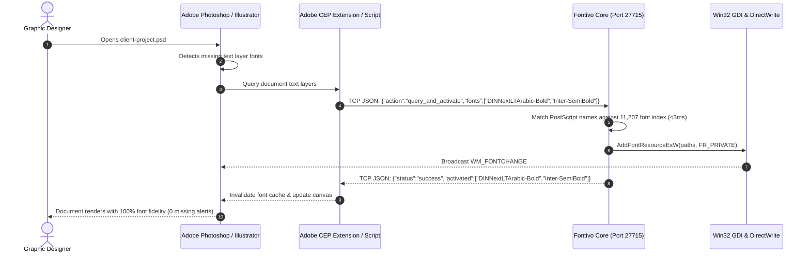

# Fontivo Adobe Creative Cloud Integration Guide

> **Real-Time Typographic Synchronization for Adobe Photoshop, Illustrator, and InDesign** 
> **Listening Port**: `127.0.0.1:27715` (TCP Raw Socket) 
> **Activation Latency**: < 10 milliseconds 
> **Supported Applications**: Photoshop CC, Illustrator CC, InDesign CC, After Effects CC (2019 – 2026+)

---

## 1. Introduction

Graphic designers frequently waste hours manually locating, downloading, and installing missing fonts whenever opening client PSD, AI, or InDesign files. Commercial tools like FontBase lock automatic Adobe CC font activation behind a **$3/month paid subscription**.

**Fontivo** provides **built-in, 100% free, permanent Adobe Creative Cloud synchronization** through a native, zero-latency background socket bridge and standalone design file inspector.

---

## 2. How the Real-Time Bridge Works

Fontivo operates an asynchronous TCP socket listener on loopback port `27715`. When an Adobe application opens a project, the Fontivo bridge communicates directly with Adobe's Common Extensibility Platform (CEP) and ExtendScript engine:



---

## 3. Supported File Types & Design File Inspector

Fontivo includes a native **Design File Inspector** that parses project files directly—even if Adobe Creative Cloud is not installed on the machine!

### Supported Formats
- **`.psd` / `.psb`**: Adobe Photoshop Document & Large Document Format (extracts `FontSet` and Text Engine records).
- **`.ai`**: Adobe Illustrator Artwork (extracts PDF/XMP stream font dicts).
- **`.indd`**: Adobe InDesign Document (extracts InDesign XML Story typographic references).
- **`.pdf`**: Portable Document Format (extracts Embedded Font Objects and TrueType/Type1 references).

### 4-Tier Visual Status Badges

When inspecting any design file in Fontivo's **Adobe CC Bridge** tab, each detected font is classified into one of four real-time tiers:

| Tier Badge | Color | Status | 1-Click Action |
| :--- | :--- | :--- | :--- |
| **مثبت بالنظام (System Installed)** | Emerald Green | The font is already permanently installed in `C:\Windows\Fonts`. | Ready to use. |
| **متاح محلياً (Local Available)** | Cyan Blue | Found in Fontivo's 11,207 library or custom folders. | **1-Click Activate to RAM** |
| **متاح في Google Fonts (Cloud)** | Amber Orange | Available in Google Fonts cloud catalog (1,961+ families). | **1-Click Download & Activate** |
| **غير موجود (Missing)** | Muted Gray | Proprietary custom foundry typeface not in catalog. | Manual import option. |

---

## 4. Multi-Document Inspector in Action

In professional studio environments, designers often work with multiple files simultaneously (e.g. social media banners in Photoshop alongside vector logo files in Illustrator).

Fontivo automatically tracks all open design documents:

1. **Document Tabs**: Each active `.psd` or `.ai` file renders as a separate collapsible card with document name and total detected font count.
2. **In-Document Search**: Filter fonts inside a specific design file by family, weight, or script.
3. **Bulk Action ("تفعيل وتحميل كل خطوط التصميم في الرام")**: One click activates all matched fonts for the entire document into RAM in under 10ms.

---

## 5. Automation Protocol Specification (Port 27715)

External scripts, CI tools, or custom Adobe CEP panels can communicate directly with Fontivo over raw TCP:

### Request Format (JSON over TCP)

```json
{
 "action": "activate_fonts",
 "fonts": [
 "DINNextLTArabic-Bold",
 "Tajawal-Black",
 "HelveticaNeue-CondensedBold"
 ]
}
```

### Success Response

```json
{
 "status": "success",
 "activated_count": 2,
 "activated_fonts": [
 {
 "postscript_name": "DINNextLTArabic-Bold",
 "family": "DIN Next LT Arabic",
 "style": "Bold",
 "path": "C:\\Users\\User\\AppData\\Roaming\\Fontivo\\Fonts\\DINNextLTArabic-Bold.ttf"
 },
 {
 "postscript_name": "Tajawal-Black",
 "family": "Tajawal",
 "style": "Black",
 "path": "C:\\Users\\User\\AppData\\Roaming\\Fontivo\\Fonts\\Tajawal-Black.ttf"
 }
 ],
 "missing_fonts": [
 "HelveticaNeue-CondensedBold"
 ],
 "time_ms": 4.2
}
```

---

## 6. Adobe CEP Integration Script Example

To query Fontivo from an Adobe Photoshop or Illustrator ExtendScript / CEP panel:

```javascript
// ExtendScript snippet for querying Fontivo bridge
function requestFontivoActivation(fontPostScriptNames) {
 var socket = new Socket();
 var payload = JSON.stringify({
 action: "activate_fonts",
 fonts: fontPostScriptNames
 });

 if (socket.open("127.0.0.1:27715")) {
 socket.write(payload + "\n");
 var response = socket.read();
 socket.close();
 return JSON.parse(response);
 }
 return null;
}
```
