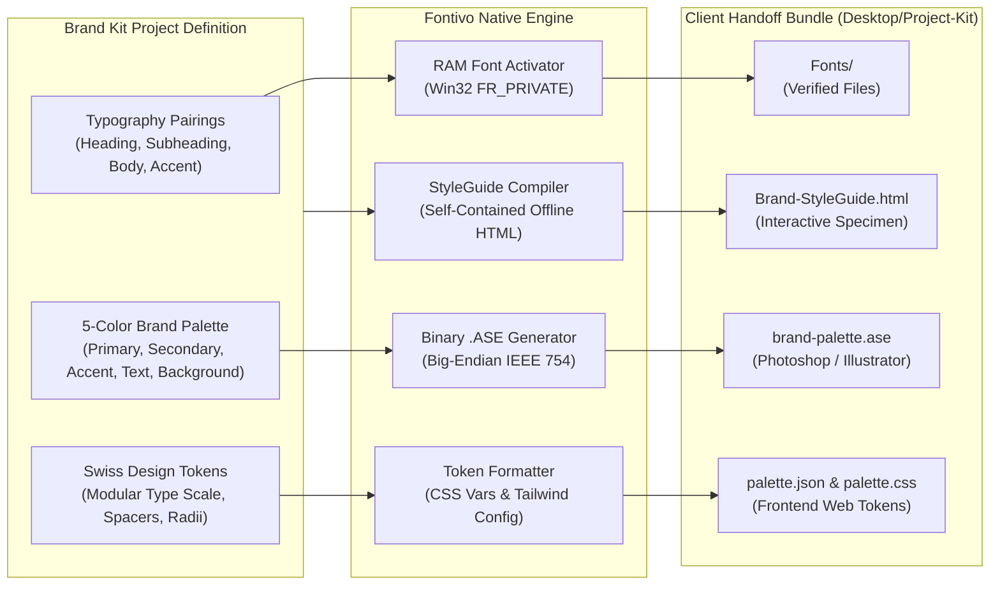

# Fontivo Brand Identity & Creative Asset Ecosystem

> **Leadership**: Directed by **Eng. Mohamed Elashwah** (Head of Brand Identity & UI/UX) & **Eng. Ahmed Fahmy** (Lead Systems Architect) 
> **Documentation Scope**: Brand Kits, Swiss Design Tokens, Binary Adobe Swatch Exchange (.ASE), WCAG 2.1 Accessibility, and Client Handoff Bundles.

---

## 1. Overview & Vision

Fontivo bridges the traditional divide between font management and brand identity engineering. Rather than treating fonts as isolated files in an OS directory, Fontivo treats typography as the central pillar of a unified brand system.

By uniting **in-memory font activation**, **design token generation**, **binary Adobe Swatch Exchange (`.ASE`) compilation**, and **automated client handoffs**, creative studios and brand architects can move from brand conception to creative software execution in seconds.

---

## 2. Brand Identity Hub Architecture

The Brand Identity Hub provides a standardized schema for managing multiple client projects, visual design tokens, and typographic hierarchies.



---

## 3. Official Fontivo Visual Identity & Core Tokens

The visual foundation of Fontivo is defined in [`assets/brand/tokens.json`](../assets/brand/tokens.json):

### 3.1. Color Palette Matrix

| Token Name | Role | HEX | RGB | Use Case |
| :--- | :--- | :--- | :--- | :--- |
| `--color-primary` | Electric Purple | `#7C3AED` | `rgb(124, 58, 237)` | Primary brand color, key interaction buttons, brand badges |
| `--color-cyan` | Cyan Blue | `#06B6D4` | `rgb(6, 182, 212)` | Secondary accent, RAM status indicators, data visualizations |
| `--color-pink` | Vivid Pink | `#EC4899` | `rgb(236, 72, 153)` | Highlight accents, active states, visual attention cues |
| `--color-navy` | Dark Navy | `#0B1020` | `rgb(11, 16, 32)` | Background dark mode foundation, deep UI canvas |
| `--color-surface` | Dark Slate Surface | `#111827` | `rgb(17, 24, 39)` | Card surfaces, modals, elevated UI containers |
| `--color-emerald` | Success Green | `#10B981` | `rgb(16, 185, 129)` | Live RAM activation dot, verification success badges |

### 3.2. Swiss Typography Tokens

Rooted in classical Swiss graphic design traditions, Fontivo establishes geometric, harmonized modular type scales:

- **Display & Headings**: Inter / Tajawal (Bold, Black)
- **Interface & Body**: Inter / Readex Pro (Regular, Medium)
- **Monospace & Numerals**: JetBrains Mono (Tabular Figures enabled)

---

## 4. Binary Adobe Swatch Exchange (`.ASE`) Compilation

A standout capability engineered by Fontivo is its **pure Rust binary `.ASE` generator**. Graphic designers no longer need to manually copy hex codes into Adobe Photoshop or Illustrator:

### 4.1. Binary Specification Adherence
1. **Magic Header**: Exactly 4 bytes: `0x41 0x53 0x45 0x46` (`ASEF`).
2. **Version**: Big-Endian 16-bit integers (`0x0001 0x0000` = v1.0).
3. **Color Block Structure**:
 - `0x0001` (Single color entry).
 - Color name encoded as length-prefixed **UTF-16 Big-Endian** with null terminator.
 - Color space identifier: 4 ASCII bytes `RGB `.
 - 3 × 32-bit Big-Endian IEEE 754 floats normalized between `0.0` and `1.0`.
 - Color type: `0x0002` (Global Swatch).

### 4.2. Instant Adobe Usage
Double-clicking `brand-palette.ase` or dropping it into the Adobe Swatches panel immediately populates the project palette with 100% color fidelity in RGB and CMYK workflows.

---

## 5. Automated Client Handoff Bundles

When completing a brand identity project, designers face the tedious chore of packaging files for clients and web developers. Fontivo automates this with **1-Click Export Bundle**:

```text
Desktop/Client-Brand-Handoff/
├── Fonts/
│ ├── Heading-Bold.ttf
│ ├── Subheading-Medium.otf
│ └── Body-Regular.ttf
├── brand-palette.ase # Adobe Photoshop, Illustrator & InDesign palette
├── palette.json # Structured JSON design tokens (HEX, RGB, HSL)
├── palette.css # Web-ready CSS custom properties (:root variables)
└── Brand-StyleGuide.html # Standalone interactive offline HTML guide
```

### 5.1. Offline Interactive Style Guide (`Brand-StyleGuide.html`)
- Completely self-contained (zero CDN or internet dependencies).
- Showcases the client brand's typography pairings, character sets, and weights.
- Features interactive color swatches with 1-click clipboard copy for HEX, RGB, and HSL.
- Renders responsive component mockups displaying how the brand fonts and colors behave on modern web cards and buttons.

---

## 6. Color Studio & WCAG 2.1 Accessibility Suite

Fontivo integrates an advanced color analysis suite:

1. **Dominant Color Extraction**: Drag and drop any brand asset (logo, poster, photography) to compute a high-precision histogram of the top 5 dominant colors.
2. **Native Win32 Screen Eyedropper**: Sample any pixel across multi-monitor setups using `/api/color/pick-screen` with a real-time 5x5 pixel magnification Loupe.
3. **WCAG 2.1 Contrast Rating**: Computes relative luminance formulas:
 $$L = 0.2126 R + 0.7152 G + 0.0722 B$$
 Evaluates contrast ratio against light (`#FFFFFF`) and dark (`#0B1020`) text, assigning strict **AAA**, **AA**, or **Fail** ratings.
4. **Mathematical Color Harmonies**: Automatically generates:
 - Complementary
 - Analogous
 - Triadic
 - Split-Complementary
 - Tetradic (Double Complementary)
 - Monochromatic variations
5. **Live Canvas Theming**: Click **Apply to Canvas** to immediately preview your fonts against the extracted brand colors in real time.
