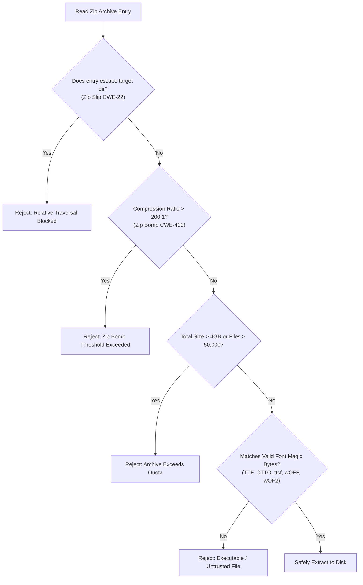

# Fontivo Security Model & Hardening Specifications

> **System Edition**: 1.0.0 (Hardened Production Release) 
> **Security Audit Status**: All 8 Vulnerability Classes Remediated & Verified 
> **Guarantees**: 100% Local-First • Zero Cloud Telemetry • Least-Privilege Execution

---

## 1. Threat Model & Security Philosophy

Fontivo operates as a local desktop application and background daemon managing sensitive user assets: fonts, brand project kits, design documents (`.psd`, `.ai`, `.indd`), and operating system typography handles.

Our threat model explicitly defends against:

1. **Malicious Web Browser Contexts**: Third-party malicious websites visited in Google Chrome, Edge, or Firefox attempting Cross-Origin Request Forgery (CSRF) or port-scanning localhost (`127.0.0.1:3920`).
2. **Untrusted Archive Payloads**: Decompression bombs (Zip Bombs) or path traversal archives (Zip-Slip) disguised as font collections.
3. **Malicious Design Files**: Specially crafted PSD/AI files attempting memory exhaustion or buffer overflow during text layer parsing.
4. **Privilege Escalation Risks**: Running unnecessary administrative rights on Windows workstations.
5. **Surveillance & Data Leakage**: Third-party telemetry, tracking SDKs, or cloud synchronization of private client typography.

---

## 2. Detailed Vulnerability Remediations & Technical Proofs

### 2.1. Local Loopback Isolation (CWE-668 / CWE-200)

- **Vector**: Daemon listeners binding to `0.0.0.0` allow any device on the local network (LAN / public Wi-Fi) to query font paths or execute commands.
- **Defense**: Both `ApiServer` (port `3920`) and `AdobeListener` (port `27715`) bind exclusively to IPv4 loopback `127.0.0.1`. Remote connection attempts are refused at the operating system socket layer.

### 2.2. Strict CORS Origin Validation (CWE-346)

- **Vector**: Default wildcard `Access-Control-Allow-Origin: *` allows malicious web pages to execute `fetch("http://127.0.0.1:3920/api/system/clean-registry")` from browser tabs.
- **Defense**: The core HTTP server inspects all incoming `Origin` headers before routing requests:
 - Allowed origins: `tauri://localhost`, `wry://localhost`, `http://localhost:3920`, `http://127.0.0.1:3920`, and direct desktop clients with no `Origin` header.
 - Foreign origins (e.g. `https://malicious-site.com`) are immediately terminated with `403 Forbidden: Cross-Origin Request Blocked`.

### 2.3. Path Traversal & File Boundary Containment (CWE-22)

- **Vector**: Static file handlers and directory importers manipulating paths with relative dot segments (`../`) or absolute Windows drive letters.
- **Defense**:
 ```rust
 // Cryptographic canonicalization containment check
 let canonical_target = target_path.canonicalize()?;
 let canonical_base = base_dir.canonicalize()?;
 
 if !canonical_target.starts_with(&canonical_base) {
 return Err(SecurityError::UnauthorizedPathTraversal);
 }
 ```
 Incoming paths are checked for null bytes (`\0`), traversal strings (`..`), and directory escaping.

### 2.4. Safe Archive Extraction (`SafeZipExtractor`)

The font download and package manager uses a custom Rust decompressor implementing five strict security layers:



### 2.5. Design File Memory Exhaustion Mitigation (CWE-400)

- **Vector**: Opening multi-gigabyte `.psd` or `.ai` files containing high-resolution raster layers leading to out-of-memory crashes.
- **Defense**: The design parser checks file extensions against an approved whitelist (`.psd`, `.ai`, `.indd`, `.pdf`, `.eps`) and streams **only the first 64 MB** of the header/XMP metadata chunks. It never buffers gigabytes of raw raster pixels into RAM.

### 2.6. Request Body Size Limiting

All HTTP POST and PUT endpoint streams are wrapped with `.take(10 * 1024 * 1024)` (10 MB maximum), preventing unauthenticated memory exhaustion attacks.

### 2.7. Windows Least Privilege Execution (`asInvoker`)

- `Fontivo.exe` declares `requestedExecutionLevel level="asInvoker"` in its embedded Windows application manifest.
- Font management uses Win32 `AddFontResourceExW(FR_PRIVATE)`, which **does not require administrator escalation**.
- Inno Setup installer uses `PrivilegesRequired=lowest`, installing cleanly to `{autopf}\Fontivo` and registering `fontivo://` protocol keys under `HKA` (`HKEY_CURRENT_USER`), avoiding UAC elevation prompts and installer error 740.

---

## 3. Privacy & Zero-Telemetry Guarantee

Fontivo collects zero telemetry. Specifically:

| Capability | FontBase / Commercial | Fontivo |
| :--- | :--- | :--- |
| **Analytics Tracking** | Mixpanel / Google Analytics | **Zero (0) Analytics** |
| **Cloud Telemetry** | Uploads active font names | **Zero Cloud Logging** |
| **User Identification** | Requires account sign-up | **No Account Required** |
| **Offline Functionality** | Degraded when offline | **100% Offline Capable** |
| **Localhost Isolation** | Often binds `0.0.0.0` | **Strict Loopback `127.0.0.1`** |
